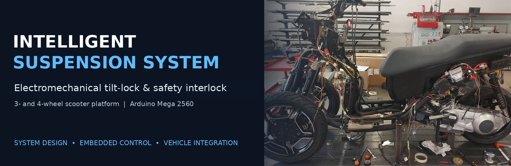
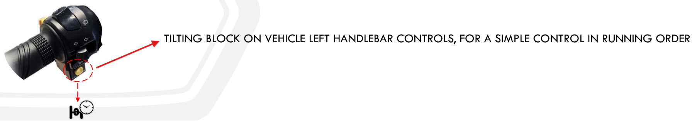
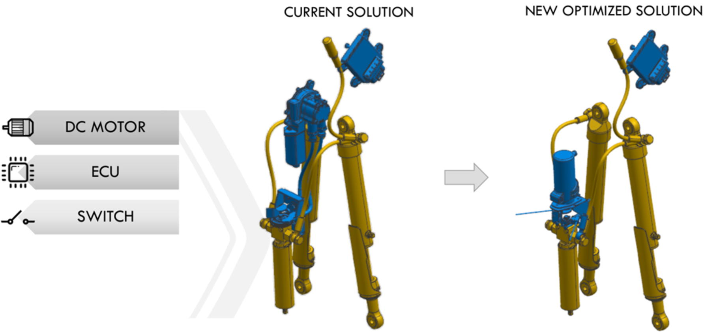
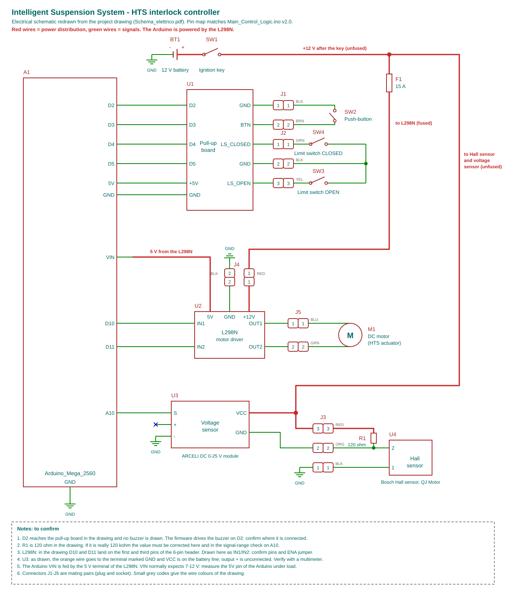
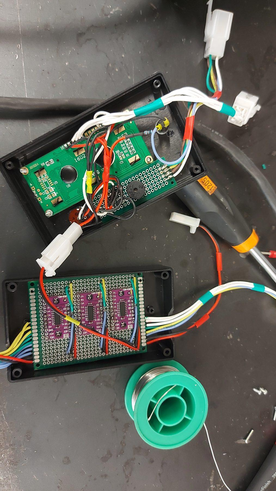
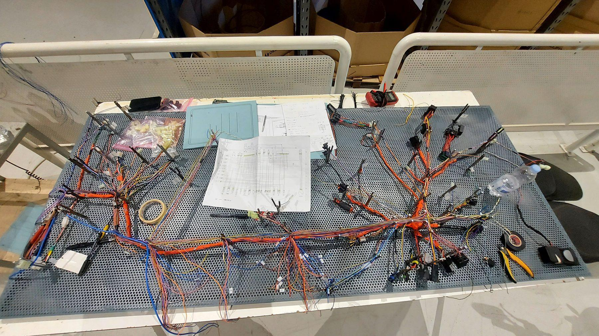
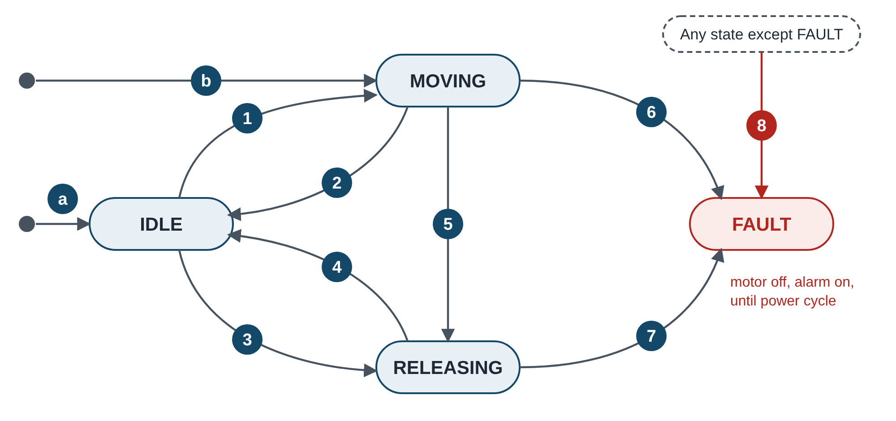
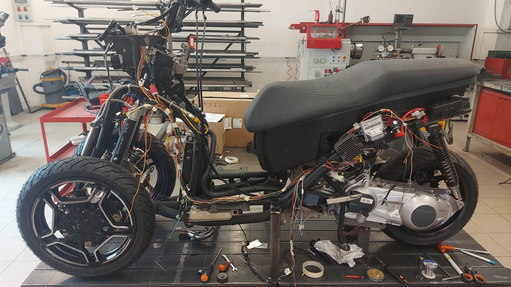

<div align="center">



# Intelligent Suspension System
### Electromechanical tilt-locking, embedded control and vehicle integration

**A cross-disciplinary R&D project for three- and four-wheel scooters**

[]()
[]()
[]()
[]()

</div>

---

## Project at a glance

I conceived, designed, prototyped and patented an electronic actuation and control solution for the **hydraulic tilting mechanism** used on three- and four-wheel scooters. The project brought together mechanical integration, electrical architecture, a vehicle-specific wiring harness, embedded firmware, fault handling and vehicle testing.

The rider can command the tilting mechanism between **OPEN** and **CLOSED** from a handlebar switch. The controller permits locking only under defined low-speed / low-acceleration conditions and automatically commands the mechanism back to **OPEN** when either safety threshold is reached.

> **My role:** end-to-end technical ownership, from concept and system interfaces to mechanical/electrical integration, firmware, prototype build, debugging and validation.

## Visual walkthrough

### 1. The concept: rider-operated electronic tilt-lock

The activation switch is integrated into the left-hand handlebar controls. The intent is a simple, accessible command without adding a complex mechanical locking arrangement.

<p align="center">
  
</p>

### 2. Mechanical actuation concept

The electronic version adds a DC motor, an electronic control unit and a handlebar switch to the existing tilting mechanism arrangement. The design work included the motor/actuator packaging and integration of the mechanism with the suspension assembly.

<p align="center">
  
</p>

### 3. Electrical architecture and control hardware

The controller is based on an **Arduino Mega 2560**. A dedicated electrical architecture defines the interfaces between the vehicle supply, rider command, wheel-speed sensing, position switches, motor driver and rider feedback.

<p align="center">
  
</p>

The control electronics were assembled in serviceable units. The HMI includes a 16×2 LCD and buzzer; signal conditioning and multiplexing support the sensor and switch interfaces.

<p align="center">
  
</p>

### 4. Wiring harness: design to vehicle installation

I designed the harness from the electrical drawings, selected connectors, terminals and wire gauges, built it on a harness board, labelled the branches and installed it on the vehicle.

<p align="center">
  
</p>

### 5. Embedded control logic

The firmware implements a non-blocking state machine with four states:

- `IDLE` — waits for rider input or a safety release condition.
- `MOVING` — drives the mechanism towards the requested position.
- `RELEASING` — overrides rider commands and returns the tilting mechanism to OPEN.
- `FAULT` — disables the motor and latches an audible alarm.

<p align="center">
  
</p>

### 6. Vehicle integration

Two prototypes were built. The dossier records bench debugging followed by vehicle installation and road testing activity at QJ Motor in China.

<p align="center">
  
</p>

---

## System architecture

| Layer | Design and implementation |
|---|---|
| Mechanical | Integration of the motor-driven locking mechanism with the tilting mechanism assembly and scooter chassis |
| Electrical | Arduino Mega 2560, H-bridge motor driver, wheel-speed signal conditioning, limit switches, push-button, LCD and buzzer |
| Wiring | Vehicle harness, connector selection, wire identification, routing and serviceable interfaces |
| Embedded software | Speed and acceleration estimation, interlock logic, actuator control, state machine, fault handling and telemetry |
| Verification | PC-based simulation of the firmware against sensor noise, limit switches, motor and mechanism models; bench and vehicle validation |

### Control hardware and interfaces

| Signal / function | Interface |
|---|---|
| Rider push-button | D3, `INPUT_PULLUP` |
| Tilting mechanism fully OPEN limit switch | D4, `INPUT_PULLUP` |
| Tilting mechanism fully CLOSED limit switch | D5, `INPUT_PULLUP` |
| Buzzer | D2 |
| H-bridge motor inputs | D10 / D11 |
| Conditioned wheel-speed signal | A10 |
| Controller | Arduino Mega 2560, 5 V logic |
| Vehicle supply | 12 V battery, ignition-key switched, 15 A fuse |

### Interlock strategy

The lock is permitted only when **both** conditions are true:

- Vehicle speed is below **7 km/h**.
- Longitudinal acceleration is below **3 m/s²**.

If either threshold is reached, the controller ignores rider lock commands and commands the mechanism to OPEN. This release command has priority over any movement already in progress.

### Fault handling and deterministic behaviour

- Every movement has a **5 s timeout**.
- Both limit switches active simultaneously are treated as an impossible mechanical/electrical condition.
- A fault immediately switches both H-bridge inputs LOW and latches an alarm until power-cycle.
- The motor is stopped before direction reversal, with a **50 ms dead time**.
- The main loop is non-blocking; sensor sampling continues while the actuator moves and while the buzzer is active.
- CSV telemetry is emitted every **200 ms** (5 Hz).

## Verification highlights

Firmware v2.0 was compiled unchanged on a PC and exercised against a model of the wheel sensor (including noise), limit switches, motor and mechanism. The simulation checks control logic and timing; it is **not a substitute for hardware validation or functional-safety certification**.

| Test case | Simulation outcome |
|---|---|
| Constant speed | Speed estimation error below 0.05% in the tested cases; acceleration noise remained within ±0.04 m/s² up to 7 km/h |
| Automatic release at speed threshold | Release initiated at measured 7.06 km/h; tilting mechanism reached OPEN 1.47 s later in the model |
| Acceleration interlock | No release at 1.5 and 2.5 m/s²; release triggered at 3.5 and 4.5 m/s² |
| Actuator jam | FAULT latched after approximately 5.03 s; motor outputs LOW |
| Impossible limit-switch state | FAULT triggered; motor outputs LOW |
| Power-up mid-travel | Mechanism returned to OPEN in 0.72 s in the model |
| Button held for 10 s | Only one movement was commanded |
| H-bridge direction safety | No simulated event with both motor inputs HIGH |

The complete simulation output is available in [`simulation/simulation_results.txt`](simulation/simulation_results.txt).

## Engineering decisions

**Timestamp-based wheel-speed estimation.** The firmware uses the timestamps of phonic-wheel tooth edges rather than relying on a simple fixed-window pulse count. This improves speed resolution and reduces quantisation noise in the acceleration estimate near the 7 km/h interlock threshold.

**Non-blocking firmware.** The controller avoids `delay()` and blocking waits. This prevents missed wheel-sensor edges while the actuator is moving or audible feedback is playing.

**Safe-direction priority.** When a release condition occurs, the firmware overrides rider input and drives towards OPEN.

**Latched fault state.** A stalled mechanism or impossible switch state disables motor drive and requires a power cycle, preventing uncontrolled repeated actuation.

**Serviceability.** Keyed connectors, labelled wires and modular control units support debugging, removal and maintenance.

## Repository structure

```text
intelligent-suspension-system/
├── README.md
└── assets/
    ├── project_banner_tilt_lock.jpg
    ├── handlebar_activation_concept.png
    ├── controller_electronics_prototype.jpg
    ├── schematic_v2.svg
    ├── electronic_motor_ecu_switch.png
    ├── firmware_state_machine.png
    ├── vehicle_prototype_integration.jpg
    └── wiring_harness_on_board.jpg
```

